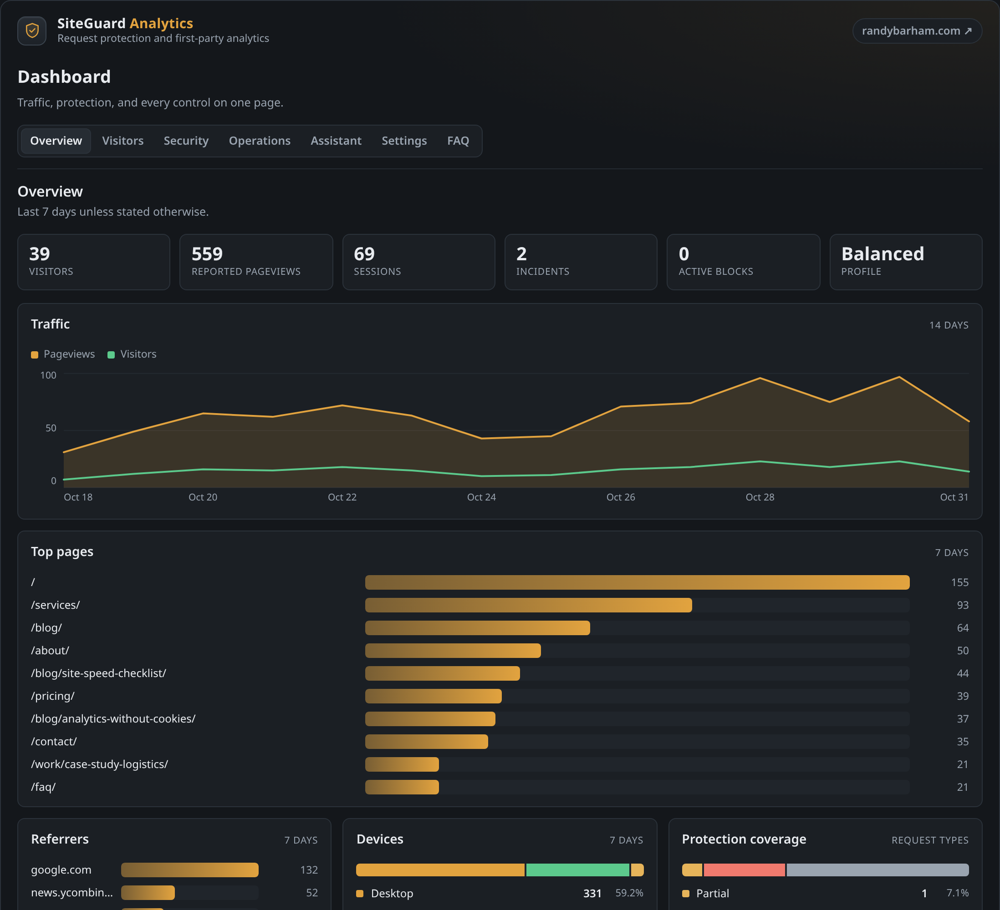

# Grey SiteGuard + Analytics

**Deterministic request protection with a fingerprint watchlist, incident records, and light first-party analytics for WordPress.**

## What is it?

Grey SiteGuard + Analytics treats a WordPress site like a network endpoint. Every request is resolved to a subject (a signed-in account, a network address, or a first-party browser id), classified into one of ten endpoint classes, and checked against that class's limits before WordPress renders anything. A client that crosses a line gets a temporary block, and an incident record stores the rule, the counter, and the evidence that caused it. The engine is deterministic: no risk score, no model, no randomness, so every block can be explained by the row it wrote. Everything lives on one admin page and runs entirely inside WordPress, with no CDN, no Redis, no root access, and no paid service.

The plugin keeps its data in its own ten `wp_sg_*` tables in the site's MySQL database: pageviews, sessions, visitors, request counters, distinct-path tracking, blocks, incidents, an audit log, and a coverage matrix. Nothing is sent to, or stored in, any external service.

It is for people who self-host a WordPress site on ordinary shared hosting and want rate limiting, incident records, and visitor-level visibility without depending on a page-cache plugin, a cloud firewall, or a third-party analytics service.

## Features

| Feature | What it does |
|---|---|
| Request classification | Maps every request to one of ten classes (page, search, feed, REST, admin-ajax, API, login, cart, checkout, download), each with its own limits |
| Three window sizes | Counts each subject in 10-second, 60-second, and hourly windows at once, using atomic single-statement upserts |
| Scan detection | Counts distinct paths per subject in ten minutes on page and search traffic; breadth beyond the limit is denied regardless of total request rate |
| Temporary blocks | A crossed limit picks a rung on a 5-minute to 24-hour ladder based on the subject's recent block count; every block expires and can be lifted by hand |
| Subject resolution | Keys on account, address, or first-party visitor id, is aware of trusted proxies before honouring forwarding headers, and collapses IPv6 to its /64 |
| Verified crawlers | Exempts a claimed bot only when forward-confirmed reverse DNS passes; results cached for 12 hours |
| Incident records | One row per escalation event with rule, class, window, count/limit, and subject, so nothing is blocked without a reason on file |
| Content-attack rules | 46 request rules score header/token anomalies, path traversal, encoding tricks, structural shape anomalies, and device-hint impossibles in the same ledger; enforcement runs off, observe, balanced, or strict, and a self-test page re-runs the shipped corpus |
| Fingerprint watchlist | Save a tampered browser's reported profile and every matching visitor scores it with graded severity; each incident names the saved profile. Candidates are drafted from recent tampering signals, the list imports and exports as JSON, and entries upsert by content so one attacker stays one entry |
| First-party analytics | Pageviews, sessions, landing and exit paths, referrers, and devices collected by the site's own endpoint with per-minute deduplication; browser-sourced rows are reported separately from server-sourced rows |
| Exports | CSV per table plus a single JSON bundle, capped at 2,000 rows per table, downloaded by the owner and never uploaded by the plugin |
| Safe operation | One admin screen with Overview, Visitors, Security, Operations, Settings, and FAQ sections; seven split capabilities; an audit log; scheduled retention; WP-CLI commands; and administrators are never enforced against |

## Install

1. Download the plugin zip from this repository's Releases page (or copy `plugin/siteguard-analytics/` into `wp-content/plugins/`).
2. In WordPress, open **Plugins > Add New > Upload Plugin**, choose the zip, then install and activate.
3. Activation creates the ten `wp_sg_*` tables, grants the `sg_*` capabilities, and schedules the retention jobs.
4. Open **SiteGuard** in the admin menu. The Balanced profile is active with enforcement on.

If activation cannot create its tables, the plugin deactivates itself and shows the reason instead of leaving the site half-installed.

## Privacy

Nothing leaves the machine. The plugin makes no outbound HTTP request and calls no external API; the only outbound traffic is standard DNS, used to reverse-resolve addresses that claim to be search engine crawlers. The Visitors screen offers one-click lookups at ipinfo, AbuseIPDB, Shodan, and RDAP, but those are plain links: nothing is sent until the administrator clicks one, from their own browser.

What is stored in the database, where: enforcement uses keyed hashes, never raw values (`ip4:...`, `ip6:...`, `a:<user id>`, `v:<visitor id>`). Analytics stores the address the server saw, the user-agent header, and the browser's reported signals (screen, time zone, languages, platform, WebGL renderer, and canvas and audio hashes) so the Visitors screen can identify a row. The `Settings > Address storage` control switches the address to a keyed hash or drops it entirely, and scheduled retention deletes old rows. The watchlist stores only what you saved: the profile's name, notes, the anchored lie rules, and the signal values those rules pin — nothing else, no addresses, no visitor ids.

## License

License: GPL-2.0-or-later, see [LICENSE](LICENSE).

The plugin is self-contained: no third-party runtime libraries are bundled.

Development: built with AI assistance and verified by tests and CI.

## Integrations

`integrations/` contains a static-site beacon collector and a Slim 4 / PSR-15 middleware that reuse the same engine.
