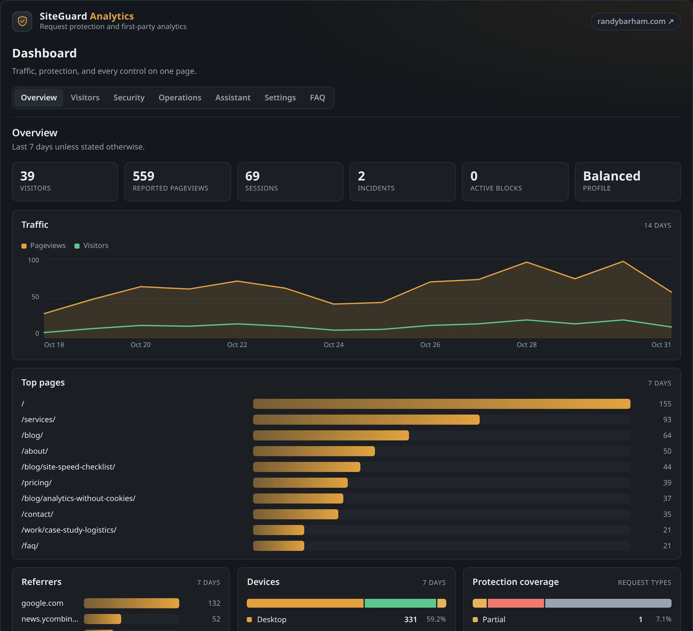
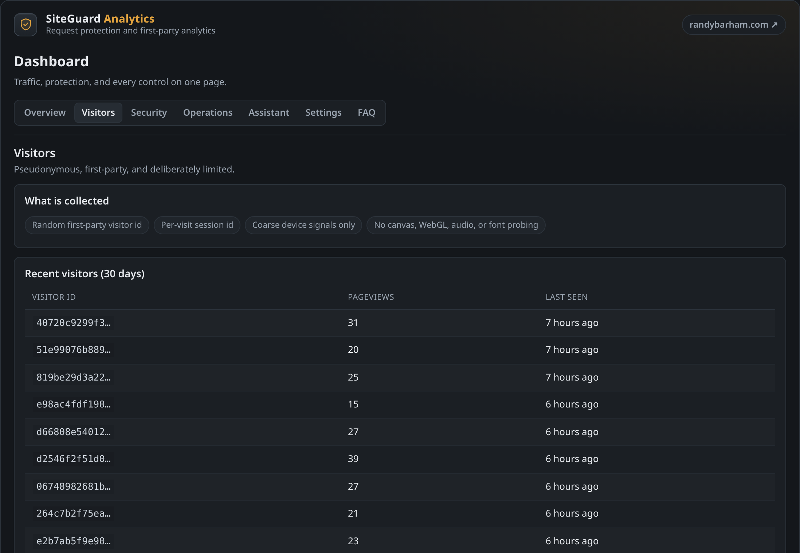
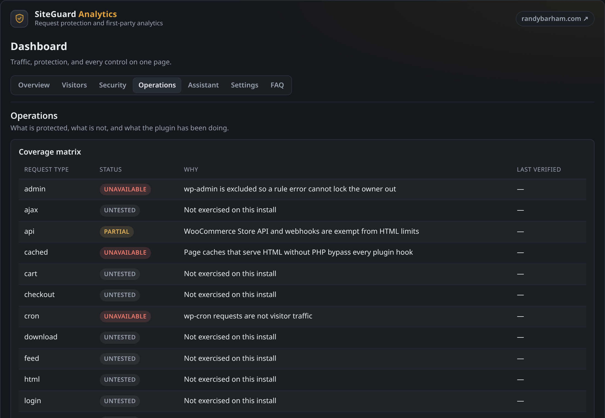
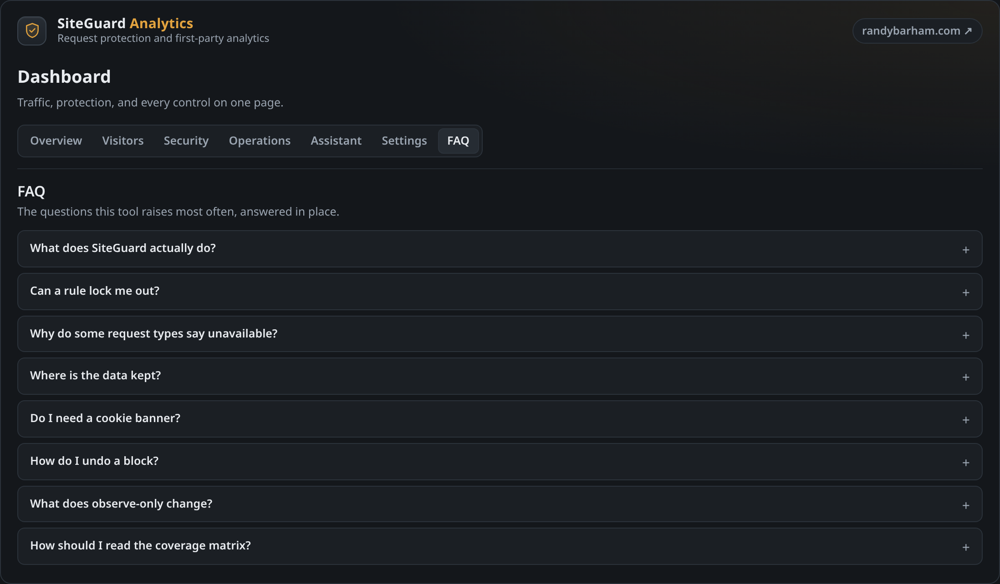

# Grey SiteGuard + Analytics

**Deterministic request protection and first-party analytics for WordPress.**

Every request is attributed to a subject, classified by what it is asking for, checked against that class's policy, and — when it crosses a line — blocked with the rule, counter and evidence written down.

[Overview](#overview) · [Screenshots](#screenshots) · [How it works](#how-it-works) · [Install](#quick-start) · [Privacy](#privacy)

---

## Overview

SiteGuard treats a WordPress site like a network endpoint. Detection and
analytics share one identity layer, so the visitor the dashboard shows is the
same subject the enforcer counted — the picture and the decision cannot
disagree. Everything runs inside WordPress: no CDN, no Redis, no root access,
no paid service.

It is not a hit counter with a throttle bolted on. The engine is deterministic:
there is no model, no risk score and no randomness, so every block can be
explained afterwards by the row it wrote.

## Screenshots

| Overview | Visitors |
| :---: | :---: |
|  |  |

| Operations | FAQ |
| :---: | :---: |
|  |  |

## How it works

1. **Attribute** — resolve who is asking: a signed-in account, a network
   address, or a first-party browser id.
2. **Classify** — resolve what the request is: a page, a search, a feed, a REST
   call, a login attempt, a checkout, or a download.
3. **Count** — increment that subject's counters for that class in three
   windows: 10 seconds, 1 minute, and 1 hour.
4. **Test breadth** — on page and search traffic, count how many different
   paths the subject asked for in ten minutes. A person reads a handful of
   pages; a scanner walks the tree.
5. **Escalate** — if a limit is crossed, choose a block length from the ladder
   based on how many times the subject has been blocked in the last seven days.
6. **Record** — write an incident naming the rule, class, counter, limit and
   subject, then hold the block until it expires.

Steps 1–5 run before WordPress does the work. Front-end traffic is checked at
`parse_request` priority 1, REST at `rest_pre_dispatch`, `admin-ajax.php` at
`init`, and the login form at `login_init`. Each surface denies in its own
format — an HTML page, a JSON error, a plain-text message — so a client
receives a correct answer instead of a broken page. Analytics runs alongside
all of this and never decides access.

### What is a subject?

A subject is the string SiteGuard counts and blocks against. It is resolved
server-side, in this order:

| Order | Subject form | Source | Forgeable? |
|---|---|---|---|
| 1 | `a:<user id>` | The WordPress account | No |
| 2 | `ip4:…` / `ip6:…` | The connection, proxy-aware | No |
| 3 | `v:<visitor id>` | A random first-party browser id | Only against itself |

A signed-in user is always counted as an account, even behind a shared office
address. IPv6 addresses collapse to their `/64`, so changing the last 64 bits
does not reset a budget. A browser id can never authorise a persistent block;
only server-resolved subjects can be blocked.

**The address is not taken on trust.** `X-Forwarded-For` and the RFC 7239
`Forwarded` header are parsed right to left, skipping hops that are themselves
trusted proxies; the first untrusted hop is the client. The chain is capped at
ten entries, so a 10 KB header cannot buy work. A forwarding header is ignored
completely unless the direct peer is inside the configured proxy list — a
client cannot claim an address by sending a header.

**A browser id can never cause a persistent block.** The visitor id comes from
a cookie and is therefore attacker-controlled. If it could authorise a stored
block, forging someone else's id would let an attacker ban its victim. So a
visitor-scope violation gets a short quota denial and nothing is written; only
server-resolved subjects (account, address) can be blocked.

## The fingerprint, and what it is for

SiteGuard computes a passive correlation fingerprint from the signals the
browser volunteers to JavaScript: language and languages, timezone and its
offset, screen size and viewport, device pixel ratio and colour depth, touch
support, CPU core count, device memory, platform, user-agent client hints
(brands, platform, mobile, model, architecture), WebGL vendor and renderer
strings, and one-way hashes of a canvas render and an audio graph. The signals
are lowercased, trimmed, sorted, and HMAC-SHA256 hashed with a site-scoped
salt. The stored value carries its version (`fp1:…`), so rotating the salt
makes old hashes stop matching instead of silently comparing across rotations.

Canvas and audio are recorded only as one-way hashes, never as images or
sound, and font enumeration and plugin lists are not read at all. Everything
else is stored as reported. These are identifying signals and the plugin does
collect them: the consent setting controls whether they are gathered, and
retention deletes them on schedule.

The fingerprint is recorded with each pageview and is never used to make a
decision. Enforcement keys on the account, the address, and the visitor id —
values the server resolves or that the browser can only use against itself.
The fingerprint is the correlation layer: two visits that share a hash share a
browser, even when the cookie has been cleared or the address has changed.
That is what lets you tell a returning script from a fresh visitor when you
investigate an incident.

## Endpoint classes and limits

A feed, a product page and a checkout have different legitimate rates. Every
request is mapped to one class, and each class carries its own policy:

| Class | Covers |
|---|---|
| `html` | Ordinary pages, the front page and posts |
| `search` | `?s=` queries and `/search/` paths |
| `feed` | `/feed/`, `/rss/`, `?feed=` |
| `rest` | `/wp-json/` routes, denied as JSON |
| `ajax` | `admin-ajax.php` |
| `api` | WooCommerce AJAX and API-shaped calls |
| `login` | `wp-login.php`, `/login`, `/signin` |
| `cart` | Cart and basket pages |
| `checkout` | Checkout, `order-pay`, `order-received` |
| `download` | Archives, PDFs, EPUBs |

`wp-admin` and `wp-cron.php` are classified but not enforced: an owner must
always be able to reach recovery, and cron is not visitor traffic. A request
that cannot be classified is allowed and marked unmanaged rather than guessed
at.

The shipped **Balanced** profile uses these limits:

| Class | 10 s | 60 s | 1 h |
|---|---:|---:|---:|
| html | 20 | 60 | 600 |
| search | 10 | 30 | 200 |
| feed | 10 | 30 | 200 |
| rest | 30 | 120 | 1200 |
| ajax | 30 | 120 | 1200 |
| api | 20 | 60 | 600 |
| login | 5 | 10 | 60 |
| cart | 20 | 60 | 600 |
| checkout | 10 | 30 | 300 |
| download | 10 | 20 | 100 |

**Strict** multiplies every limit by 0.5. **Observe** records everything and
denies nothing, which is how to tune a new site before turning enforcement on.
A signed-in account receives a 2× multiplier by default.

The breadth rule adds a second dimension: more than 150 **distinct** paths
within ten minutes is a scan, whatever the total request rate. Only a
truncated SHA-256 of the path is stored, never the URL.

When a rule is crossed, the block ladder is 300 seconds, 15 minutes, 1 hour,
6 hours, then 24 hours. The rung is chosen by how many blocks that subject has
received in the previous seven days, and the last rung is a ceiling, not a
permaban. Every block expires and can be lifted early from the Security tab.

## The trust boundary

The design assumes the browser is hostile and the server is the only source of
truth. Four rules follow from that, and they are worth knowing before you rely
on a number.

- **Browser telemetry never enforces.** A visitor id can be a secondary subject
  when a block is evaluated, but it cannot create a stored block, and the
  dashboard reports browser-sourced pageviews separately from server-sourced
  requests.
- **A replayed beacon cannot inflate the numbers.** The collector accepts only
  32-hex ids, a whitelisted event type and a path beginning with `/`; a
  duplicate visitor/session/type/path in the same minute is rejected by a
  unique index.
- **Verified crawlers are exempt; impostors are not special.** A claimed
  Googlebot is accepted only when the address resolves to an operator hostname
  and that hostname resolves back to the same address — forward-confirmed
  reverse DNS, cached for 12 hours. A fake bot header gets no exemption, and no
  extra punishment.
- **Storage failure fails open.** If a counter or block lookup throws, the
  request is allowed and the error is recorded for diagnostics.

**Administrators are never enforced against**, independent of the emergency
stop.

## What you see

Everything lives on one admin page. The strip under the title switches
sections; with JavaScript off, every section stays on the page and the strip
links to it.

| Tab | What is there | Open it when |
|---|---|---|
| Overview | Traffic chart, top pages, referrers, devices, coverage | Daily check |
| Visitors | One clickable row per browser: address, user agent, fingerprint, sessions, pages | You want to see who is returning |
| Security | Active blocks, incidents, a manual block form | Something looks abusive |
| Operations | Coverage matrix, diagnostics, CSV/JSON exports, emergency stop | Setup, or something is wrong |
| Settings | Profile, limits, retention, address storage | You want different rules |
| FAQ | Eight answers to the questions this tool raises | First install |

The Security tab is the investigation surface: active blocks with their rule
and remaining time, and a recent-incident table showing when, which subject,
which rule, and the evidence (`class · window · count/limit`).

The Visitors tab is the identity surface. Each row shows the address, browser
class, page count and last-seen time; clicking the visitor id opens everything
recorded for that browser: every address it used with one-click lookups at
ipinfo, AbuseIPDB, Shodan and RDAP; the raw user agent; the full fingerprint
(screen, viewport, time zone, languages, CPU cores, device memory, client
hints, WebGL vendor and renderer, canvas and audio hashes); its sessions; its
recent pageviews; and any signed-in accounts it was seen under.

## Quick start

1. Download `grey-siteguard-analytics-0.1.13.zip` from
   [Releases](https://github.com/greyok00/siteguard-analytics/releases).
2. In WordPress, open **Plugins → Add New → Upload Plugin**, choose the ZIP,
   then **Install Now** and **Activate**.
3. Activation checks PHP, MySQL and `$wpdb`, creates ten `wp_sg_*` tables,
   grants seven `sg_*` capabilities to administrators, and schedules two cron
   events.
4. Open **SiteGuard** in the admin menu. The Balanced profile is active with
   enforcement on.

If activation cannot create its tables, the plugin deactivates itself and
shows the reason instead of leaving the site half-installed.

### First ten minutes

1. Open **Overview**. The traffic chart should show today's visits; if every
   number is zero, see [If nothing is recorded](#if-nothing-is-recorded).
2. Open **Operations → Coverage matrix**. The Why column says what this install
   can and cannot see, and why.
3. Let it run for a day, then open **Security** to review incidents.
4. If the site is small and strictness matters more than comfort, set
   **Settings → Profile → Strict**.

### Settings you will actually change

| Setting | Default | Change it when |
|---|---|---|
| Profile | Balanced | Strict doubles protection; Observe records without blocking |
| Enforcement | On | Turn off to keep counting while tuning limits |
| Collection | On | Turn off to stop the front-end collector |
| Address storage | Keyed hash | `full` keeps raw addresses; `none` stores neither |
| Trusted proxies | empty | Your host sits behind a load balancer or CDN |
| Block ladder | 300 s → 24 h | You want shorter or longer blocks |

### Blocks and how to undo them

Blocks expire on their own, and administrators are never blocked, so a bad rule
cannot lock you out. To lift one early, open **Security** and press **Lift**
next to the client; the row shows the rule and the time left.

Three independent stops are available:

1. **Emergency stop** in Operations — one click, written to the audit log.
2. `add_filter('siteguard_emergency_disabled', '__return_true');` in a theme or
   mu-plugin.
3. `define('SITEGUARD_DISABLED', true);` in `wp-config.php` — stops enforcement
   and collection before the plugin boots.

## If nothing is recorded

- **The page is cached.** A cache serves HTML without running PHP; the plugin
  never sees the request. Exclude protected paths from the cache, or accept
  that the numbers are views that reached PHP.
- **Collection is off.** Settings → Collection.
- **Consent is required and not given.** Settings → Consent.
- **You are looking at a file served by the web server.** Static files bypass
  WordPress entirely.

## What it cannot protect

A plugin only sees requests that reach PHP. The dashboard states this rather
than implying full coverage.

| Surface | Protected | Why |
|---|---|---|
| Pages, search, feeds, downloads | Yes | `parse_request` runs first |
| REST API | Yes | `rest_pre_dispatch` returns JSON errors |
| `admin-ajax.php` | Yes | `init`, only for AJAX |
| `wp-login.php` | Yes | `login_init` |
| `wp-admin` | No, on purpose | An administrator must always get in |
| Cached pages | No | The cache answers without PHP |
| Static files | No | They never reach WordPress |
| CDN / WAF rules | No | Configured outside WordPress |

## Privacy

Enforcement subjects are keyed hashes, not raw values: `ip4:…`, `ip6:…`
(collapsed to `/64`), `a:<user id>` and `v:<first-party visitor id>`. A block
is written against the hash, so the rules never need the address itself.

Analytics is the opposite by design, and this is a deliberate choice rather
than an oversight. The collector stores the visitor address as the server saw
it, the user-agent header, and the fingerprint values the browser reports, so
the Visitors screen can answer "who is this". **Settings → Address storage**
switches the address to a keyed hash or drops it entirely; the fingerprint and
user agent are still recorded. Nothing is sent anywhere: the plugin has no
model, no analytics service and no outbound call in normal operation.

The collector is first-party and does not track across sites. It honours Do Not
Track when consent is `optional` or `required`, and in those modes waits for
`localStorage.sg_consent` to be `1`.

This is visitor-level data. It belongs in your retention schedule, and it is
personal data in most jurisdictions — treat an export the way you would treat a
visitor log, and delete it when you no longer need it.

## Exports and analysis

There is no built-in assistant and no API key fields. The plugin records; you
decide where the record goes.

Operations offers a CSV per table (events, sessions, visitors, incidents,
blocks, audit) and a **JSON bundle** — one document holding every table, capped
at 2,000 rows each, newest first, with the true row counts in a `counts` field.
Download it and hand it to a notebook, a script or a chat window. Nothing is
uploaded by the plugin.

Why it is built this way: once rows carry addresses and fingerprints, a
server-side model call is an outbound transfer of personal data that the plugin
performs on your behalf. An export you carry yourself has none of that
ambiguity, and it works with any tool you choose.

## Requirements

- WordPress 6.4 or newer, PHP 8.1 or newer.
- MySQL 5.7+ or MariaDB 10.3+.
- No root access, no Redis, no external service.

## Documentation

- [`plugin/grey-siteguard-analytics/docs/README.md`](plugin/grey-siteguard-analytics/docs/README.md) — user guide, defaults, recovery, privacy

## License

GPL-2.0-or-later. See [LICENSE](LICENSE).
